<p align="center">
  
</p>

<div align="center">

# ✦ Banco de Evaluaciones ✦

### 📝 Módulo de banco de preguntas y evaluaciones para educación técnica de nivel superior

#### Demo técnico de 🎮 Studios Conari SpA · 🇨🇱 Concepción, Chile

<br>

[](https://manecist.github.io/banco-evaluaciones-demo/)

**[manecist.github.io/banco-evaluaciones-demo](https://manecist.github.io/banco-evaluaciones-demo/)** · funciona completo en el navegador, sin instalar nada

### [✅ Prueba de integración con Moodle 4.5 realizada: ver informe](docs/prueba-integracion-moodle/)

<sub>16-10-2026 · ida y vuelta con un Moodle 4.5 real (ambiente QA en Google Cloud Run) · 9 de 9 preguntas reconocidas · notas idénticas · sin datos personales · [descargar evidencia (.zip)](docs/prueba-integracion-moodle/prueba-integracion-banco-moodle.zip)</sub>

<br>


[](https://github.com/manecist/banco-evaluaciones-demo/actions/workflows/ci.yml)

</div>

> [!IMPORTANT]
> **Prueba de capacidad técnica con datos ficticios.** Este repositorio es una demostración elaborada por
> Studios Conari SpA. **No es un sistema de ninguna institución** ni contiene información real: personas,
> carreras, asignaturas, preguntas y respuestas de estudiantes fueron inventadas para el demo.

---

# ✦ La idea

Un banco de preguntas donde los docentes **escriben, revisan, reutilizan y analizan** sus evaluaciones, con un recorrido completo:

<div align="center">

**📄 Prueba en papel** → **🤖 Importación** → **✍️ Redacción guiada** → **🔎 Revisión** → **✅ Aprobación** → **🖨️ Papel o 💻 Moodle** → **⚡ Corrección automática** → **📊 Análisis**

</div>

<br>

> **La IA ayuda, pero no decide: la respuesta correcta siempre la confirma una persona.**

---

# 🧩 Qué incluye

### ✍️ Para el docente

| | |
|---|---|
| 📝 **Nueva pregunta en 5 pasos** | Ayuda bajo cada campo, ejemplo de un clic y un **torpedo** con los niveles de Bloom, consejos para buenas alternativas y qué pasa después de guardar. |
| 💡 **Asesor con soluciones** | Revisa mientras se escribe (verbo y nivel de Bloom, absolutos como «nunca», clave más larga, alternativas repetidas). Cada consejo explica **cómo corregirlo** y, cuando se puede, lo **arregla con un clic**. |
| 🤖 **Segunda opinión de IA** | Dice qué alternativa considera correcta, por qué, y si coincide con la marcada. Antes de enviar el texto elimina RUT, correos y teléfonos, y valida la respuesta contra un esquema. |
| 📄 **Importar pruebas antiguas** | Una prueba escaneada, en Word o PDF se separa en preguntas, alternativas y respuesta correcta; el docente confirma y entran como borradores. |
| 🔍 **Búsqueda en español** | Tolera tildes y errores de tipeo: «presion» encuentra «presión» (`unaccent` + `pg_trgm`). |

### 🔎 Para la revisión

| | |
|---|---|
| ✅ **Flujo de visación** | Borrador → recepcionado → en revisión → visado o devuelto. Nadie aprueba sus propias preguntas y devolver exige un comentario (verificado en el servidor). |
| 🧭 **Ayuda para revisar** | Pauta de revisión, lo que detectó el asesor y la segunda opinión de IA. |
| 👩‍⚕️ **Consulta a par experto** | Si la revisora duda o discrepa con el docente, pide la opinión de un experto. La **jefatura solo interviene en ese caso**: responde o asigna a alguien de la especialidad. Mientras tanto, la pregunta no se puede aprobar. |
| 🔒 **Versiones inmutables** | Cada cambio crea una versión nueva; un *trigger* de PostgreSQL impide modificar o borrar las anteriores. Todo queda en la auditoría. |

### 🖨️ Pruebas y resultados

| | |
|---|---|
| 📐 **Tabla de especificaciones** | Pesos por resultado de aprendizaje que suman 100 %, solo preguntas aprobadas, semáforo de cobertura en vivo y tiempo estimado. |
| 🔀 **Formas A y B** | Preguntas y alternativas barajadas con semilla (reproducible), tabla de conversión a nota 1,0–7,0, pauta separada, impresión o PDF y exportación a **Moodle XML**. |
| 🔄 **Integración con Moodle** | Ida y vuelta: la prueba se **envía a Moodle** (XML), los estudiantes la rinden en línea con **nota al instante**, y el **informe de respuestas vuelve al banco sin nombres ni correos**. Cada respuesta se calza con su pregunta aunque Moodle baraje el orden, y se actualiza el análisis. Guía paso a paso: [`GUIA-MOODLE.md`](GUIA-MOODLE.md) · ✅ [Informe de la prueba real con Moodle 4.5](docs/prueba-integracion-moodle/). |
| ⚡ **Corrección de hojas de respuesta** | Hoja imprimible para lector óptico. Se sube el archivo de marcas y el sistema **corrige en segundos**: notas, hojas a revisar a mano (doble marca, en blanco) y descarga de resultados. |
| 📊 **Análisis de ítems** | Dificultad (p), discriminación (D, 27 %), punto biserial corregida y distribución de notas. Alertas con explicación: **PRIORITARIAS** (clave probablemente errónea, pregunta ambigua, discriminación negativa) y **menores** (muy fácil, muy difícil, distractor que nadie elige). Muestra el **origen de los datos** (simulados, hojas escaneadas, Moodle) y permite filtrar por cada uno. |

### 👥 Cada rol con su función

| Rol | Qué hace |
|---|---|
| 💻 **Docente** | Escribe preguntas, importa pruebas antiguas, arma pruebas, las aplica en papel o en Moodle y revisa los resultados. |
| 🔎 **Revisor/a** | Revisa, aprueba o devuelve; consulta a un experto cuando lo necesita. |
| 📚 **Área Curricular** | Cuida la calidad: programas, reglas, revisión en todas las carreras y archivo. |
| 🎓 **Jefatura de carrera** | Panel de su carrera y atención de consultas a experto. |
| 🧑‍🏫 **UTA** | Ajustes pedagógicos: exigencia, tolerancia y respuestas mínimas para el análisis. |
| ⚙️ **Administración** | Ajustes técnicos (IA y límites de uso) y usuarios y roles. |

El flujo de aprobación está pensado para ser **configurable por la institución**: una carrera pequeña puede usar solo docente → revisor → aprobada.

**No incluye**, por ser un demo: inicio de sesión institucional real (SSO), integración con sistemas académicos reales, un proveedor de IA real, un lector óptico real ni una conexión directa a un Moodle (los archivos se intercambian; ver la guía). La IA, el reconocimiento de texto de archivos y las hojas escaneadas están **simulados** con ejemplos.

---

# ✦ Galería

<div align="center">

<p align="center">
  <a href="docs/capturas/03-editor-asesor.png">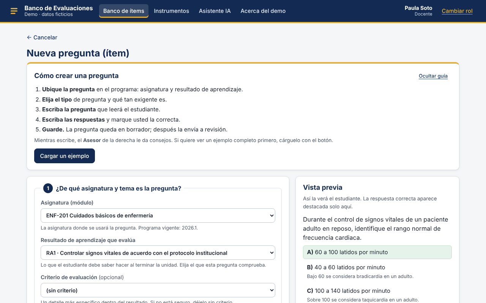</a>
  &nbsp;
  <a href="docs/capturas/04a-ayuda-revisora.png">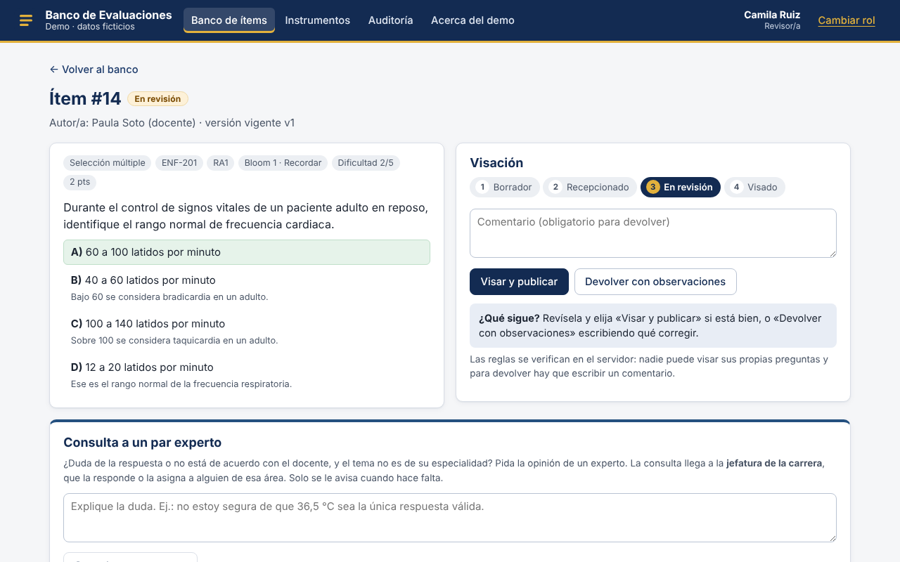</a>
</p>
<sub>Nueva pregunta en 5 pasos · Ayuda para la revisora</sub>

<p align="center">
  <a href="docs/capturas/18-importar-prueba.png">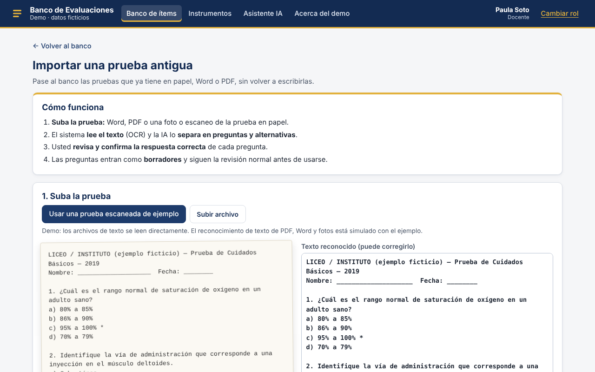</a>
  &nbsp;
  <a href="docs/capturas/19-corregir-hojas.png">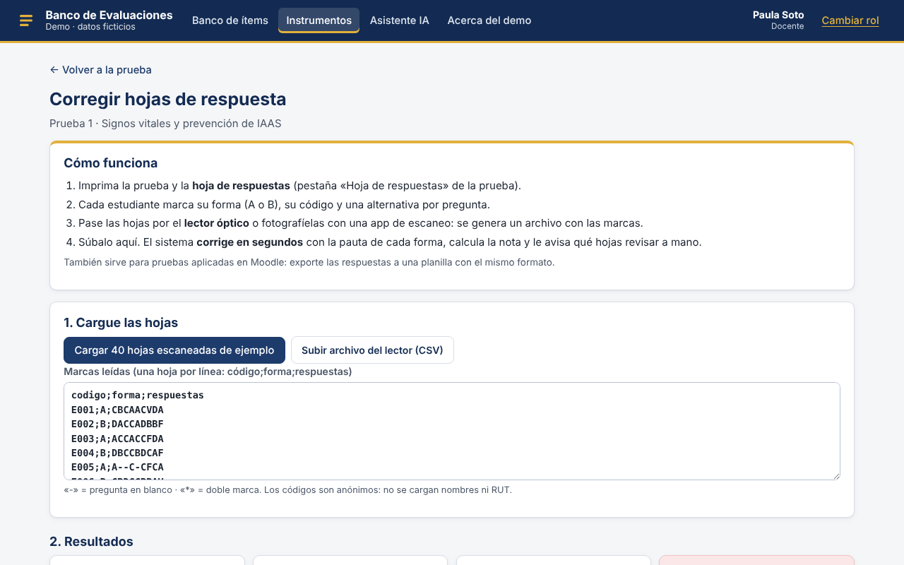</a>
</p>
<sub>Importar una prueba antigua · Corregir 40 hojas en segundos</sub>

<p align="center">
  <a href="docs/capturas/20-resultados-moodle.png">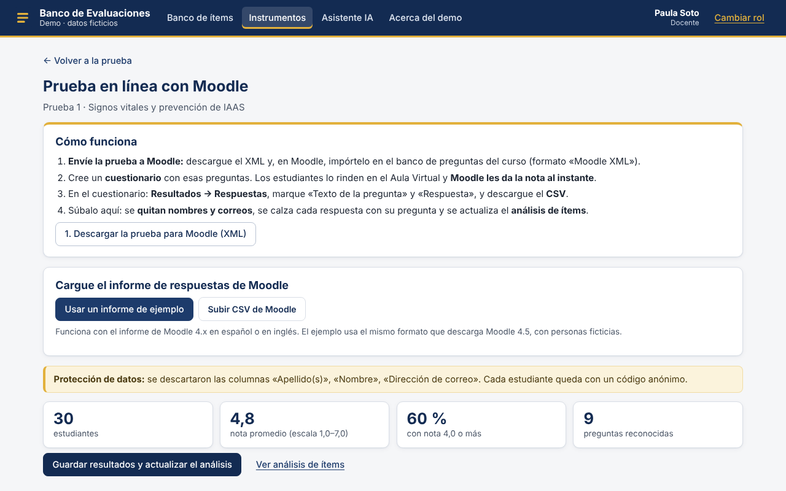</a>
  &nbsp;
  <a href="docs/capturas/09c-hoja-respuestas.png">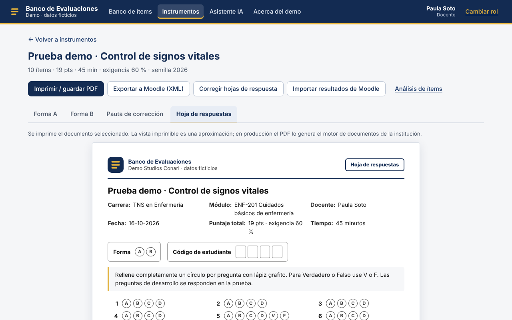</a>
</p>
<sub>Resultados que vuelven de Moodle · Hoja de respuestas para lector óptico</sub>

<p align="center">
  <a href="docs/capturas/04c-experta-responde.png">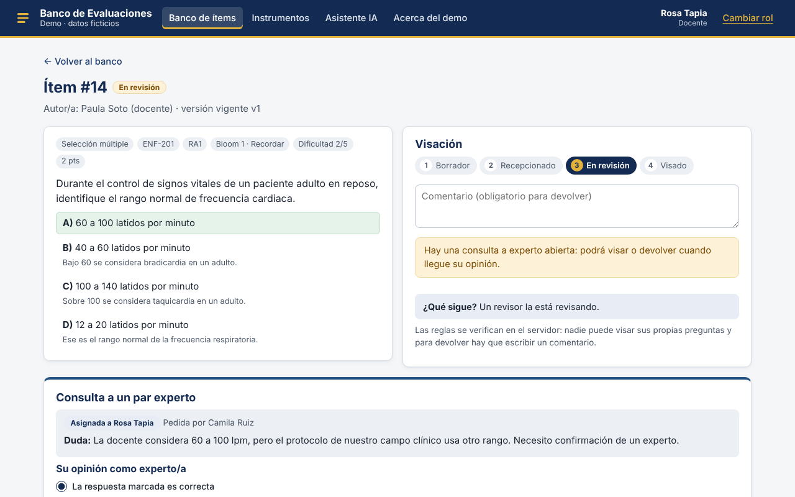</a>
  &nbsp;
  <a href="docs/capturas/10-analisis.png">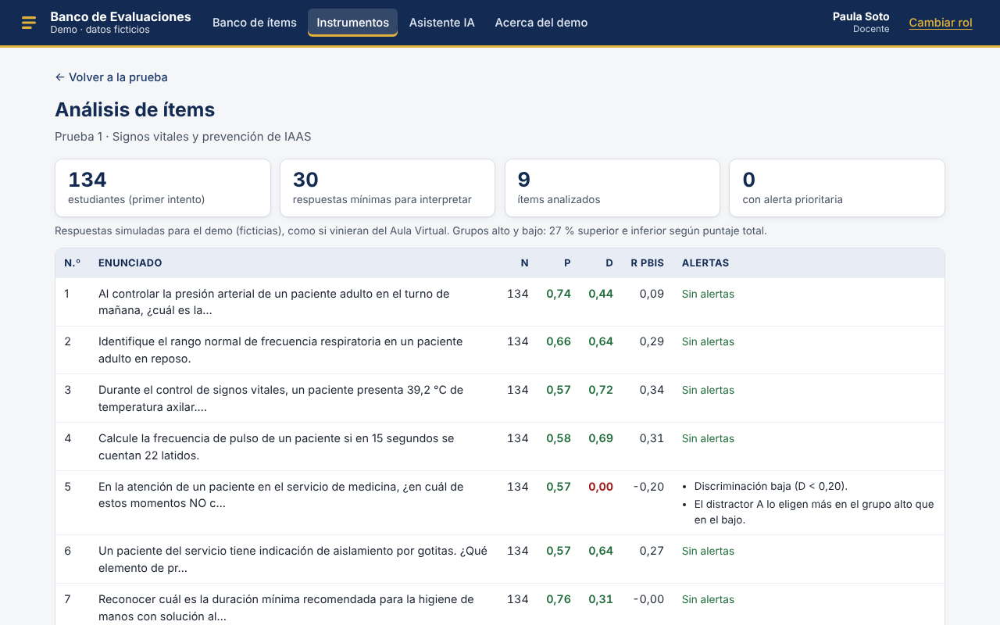</a>
</p>
<sub>Consulta a par experto · Análisis de ítems</sub>

<p align="center">
  <a href="docs/capturas/07-forma-a.png">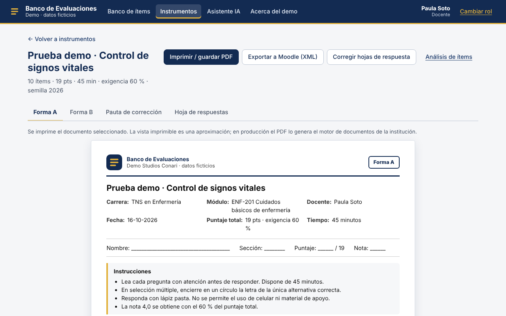</a>
  &nbsp;
  <a href="docs/capturas/15-panel-jefatura.png">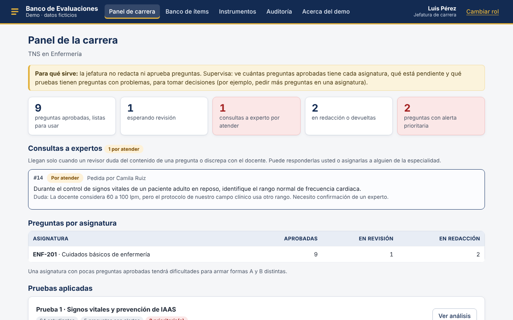</a>
</p>
<sub>Forma A imprimible · Panel de la jefatura</sub>

<p align="center">
  <a href="docs/capturas/01-inicio.png">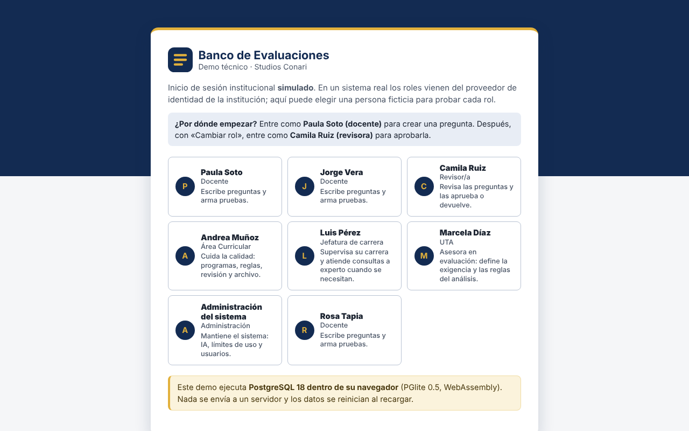</a>
  &nbsp;
  
</p>
<sub>Inicio con roles ficticios · Vista en celular (380 px)</sub>

</div>

---

# 🚀 Cómo probarlo

### 1. En línea (recomendado)

Abra **[el demo](https://manecist.github.io/banco-evaluaciones-demo/)** y elija una persona ficticia. Recorrido sugerido:

1. **Paula Soto (docente):** busque «presion». Luego «+ Nueva pregunta» → «Cargar un ejemplo» → pida la segunda opinión de IA → guarde → «Enviar a revisión».
2. **Camila Ruiz (revisora):** abra la pregunta, tómela para revisión y use la «Ayuda para revisar». Pruebe «Consultar a un experto».
3. **Luis Pérez (jefatura):** en su panel, asigne la consulta a **Rosa Tapia**, que responde. Después Camila aprueba.
4. **Paula:** «Importar prueba antigua» con el ejemplo escaneado. En «Instrumentos», arme una prueba y vea las formas A y B, la pauta y la hoja de respuestas.
5. **Prueba 1:** «Corregir hojas de respuesta» → «Cargar 40 hojas escaneadas de ejemplo» → «Guardar notas». Luego «Importar resultados de Moodle» → «Usar un informe de ejemplo» → «Guardar resultados» → «Análisis de ítems».
6. **Marcela Díaz (UTA)** y **Administración:** «Configuración». **Andrea Muñoz (Área Curricular):** «Auditoría».

Al recargar la página, todo vuelve a su estado inicial.

### 2. Con Docker (API + PostgreSQL 16)

```bash
cp .env.example .env      # luego reemplace las claves de ejemplo
docker compose up --build
```

Abra http://localhost:3000 · especificación OpenAPI en http://localhost:3000/api/openapi.json

### 3. Desarrollo local (Node.js 20+)

```bash
npm install
npm run dev:demo          # demo en el navegador con PGlite (sin base de datos)
```

Para trabajar contra PostgreSQL: defina `DATABASE_URL` y `JWT_SECRET`, ejecute `npm run migrate -w @banco/server` y luego `npm run dev:server` junto con `npm run dev:client`.

---

# ⚙️ Arquitectura

| Paquete | Contenido |
|---|---|
| 🧱 **`packages/core`** | Modelo PostgreSQL, esquemas Zod, permisos, asesor, análisis, notas, formas y corrección de hojas, Moodle, IA e importación. TypeScript puro. |
| 🌐 **`packages/server`** | API REST con Express 5 + `pg`, sesión JWT de demostración y **OpenAPI 3.1 generado desde los mismos esquemas** que validan cada ruta. |
| 🎨 **`packages/client`** | Interfaz React + Vite, responsiva hasta 380 px, con foco visible y contraste AA. |

La **misma capa de datos** funciona de dos formas:

- **Con servidor:** React → API REST → PostgreSQL 16.
- **Demo en línea:** React → `packages/core` → **PGlite**, que es PostgreSQL compilado a WebAssembly dentro del navegador: el mismo SQL, los mismos permisos y las mismas validaciones, sin servidor.

---

# 🧪 Pruebas

```bash
npm run typecheck         # TypeScript estricto en los tres paquetes
npm test                  # Vitest: núcleo y API
npm run build:demo        # demo estático en docs/
```

**40 pruebas automatizadas** sobre PostgreSQL real (PGlite). Cubren, entre otras cosas, la búsqueda tolerante, la inmutabilidad de versiones, las reglas de visación, la consulta a experto, los permisos por rol, la importación de pruebas antiguas, la corrección de hojas, la vuelta de resultados desde Moodle, el análisis de ítems y la API. **GitHub Actions** ejecuta en cada cambio la revisión de tipos, las pruebas, el build del demo y el build de la imagen Docker.

---

<div align="center">

## ✦ Tecnología · Educación · Construcción de proyectos ✦

### 🎮 Studios Conari SpA

[](https://github.com/manecist)
[](https://studiosconari.github.io/)
[](mailto:studiosconari@gmail.com)

<br>

© 2026 Studios Conari SpA. Todos los derechos reservados · ver [`LICENSE`](LICENSE)

<sub>Los componentes de terceros (React, Node.js, Express, PostgreSQL, PGlite, Zod, Vite y otros) se rigen por sus propias licencias.</sub>

</div>
