# Banco de Evaluaciones — demo técnico

**Módulo de banco de ítems y evaluaciones para educación técnica de nivel superior**
TypeScript · Node.js · API REST + OpenAPI · React · PostgreSQL 16 · Docker Compose

<p align="center">
  <a href="https://manecist.github.io/banco-evaluaciones-demo/"><b>▶&nbsp;&nbsp;Abrir el demo en línea</b></a><br />
  <sub>https://manecist.github.io/banco-evaluaciones-demo/ · funciona completo en el navegador, sin instalar nada</sub>
</p>

> [!IMPORTANT]
> **Prueba de capacidad técnica con datos ficticios.** Este repositorio es una demostración elaborada por
> Studios Conari SpA. No es un sistema de ninguna institución ni contiene información real: personas,
> carreras, módulos, ítems y respuestas de estudiantes fueron inventados para el demo.

[](https://github.com/manecist/banco-evaluaciones-demo/actions/workflows/ci.yml)

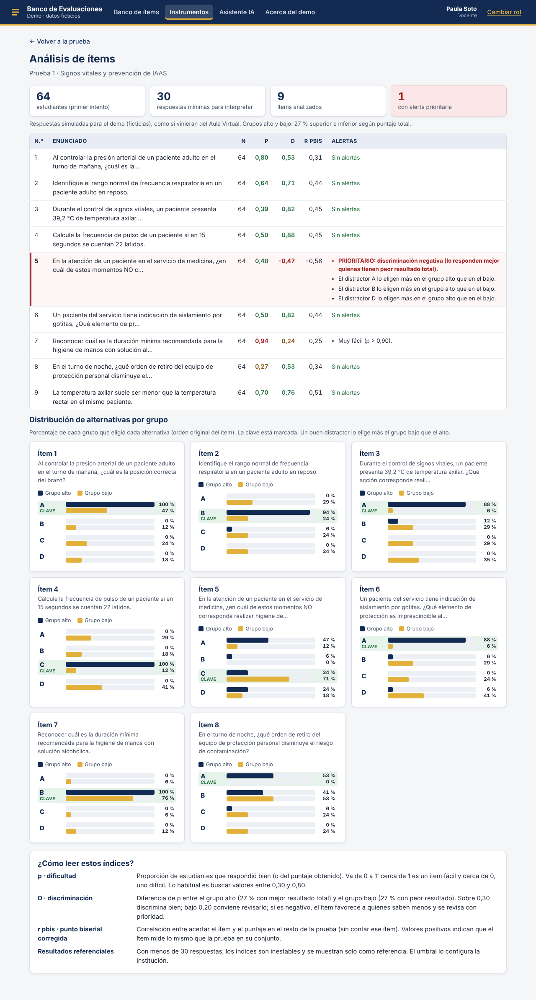

---

## Qué incluye

| Área | Qué se puede probar |
|---|---|
| **Banco de ítems** | Cinco tipos de ítem (selección múltiple, verdadero o falso, respuesta breve, pareados y desarrollo). Búsqueda en español que tolera tildes y errores de tipeo: «presion» encuentra «presión» (PostgreSQL `unaccent` + `pg_trgm`). |
| **Metadatos curriculares** | Carrera, módulo, resultado de aprendizaje, criterio de evaluación, nivel de Bloom, dificultad y versión del programa. |
| **Asesor de redacción** | Reglas explicables mientras se escribe: verbo del enunciado frente al nivel de Bloom declarado, absolutos («nunca», «siempre»), clave más larga que los distractores, falta de retroalimentación. Cada sugerencia se acepta o se descarta y la decisión queda registrada. |
| **Flujo de visación** | Borrador → recepcionado → en revisión → visado o devuelto. Las reglas se verifican en el servidor: nadie visa lo propio y devolver exige un comentario. |
| **Versiones inmutables** | Cada cambio crea una versión nueva. Un *trigger* de PostgreSQL rechaza cualquier modificación o borrado de una versión existente. Editar un ítem visado crea un borrador y la versión publicada sigue vigente. |
| **Armado de pruebas** | Tabla de especificaciones con pesos por resultado de aprendizaje (deben sumar 100 %), solo con ítems visados, semáforo de cobertura en vivo y estimación del tiempo de respuesta. |
| **Formas A y B** | Orden de preguntas y alternativas barajado con semilla (reproducible), tabla de conversión de puntaje a nota 1,0–7,0 con exigencia configurable, pauta de corrección separada e impresión o PDF desde el navegador. |
| **Moodle** | Exportación de una prueba al formato XML de Moodle (solo ítems visados). |
| **Análisis de ítems** | Dificultad (p), discriminación (D, grupos 27 % superior e inferior), punto biserial corregida, alertas con prioridad y distribución de alternativas por grupo alto y bajo. Usa 64 respuestas simuladas. |
| **Asistente de IA** | Genera borradores a partir de un resultado de aprendizaje. Antes de enviar el texto elimina RUT, correos y teléfonos; valida la respuesta contra un esquema; los borradores quedan marcados y pasan por la misma visación humana. En el demo el proveedor es **simulado**, sin costo y sin llamadas externas. |
| **Roles y auditoría** | Seis roles (docente, jefatura de carrera, revisor/a, Área Curricular, UTA, administración) con una matriz de permisos aplicada en cada ruta de la API, más una bitácora de auditoría de solo lectura. |

**No incluye**, por ser un demo: inicio de sesión institucional real (SSO/OIDC), integración con un SGA o Aula Virtual reales, un proveedor de IA real ni un motor PDF institucional.

## Arquitectura

```
banco-evaluaciones-demo/
├── packages/core     Modelo de datos y reglas de negocio (TypeScript puro)
│   ├── schema.ts         Tablas PostgreSQL, extensiones, trigger de inmutabilidad
│   ├── types.ts          Esquemas Zod (validación de entrada compartida)
│   ├── permissions.ts    Matriz de roles y flujo de visación
│   ├── repo.ts           Capa de datos (SQL parametrizado)
│   ├── advisor.ts        Asesor por reglas y semáforo de cobertura
│   ├── analysis.ts       p, D y punto biserial corregida
│   ├── grading.ts        Conversión a nota y barajado con semilla
│   ├── moodle.ts         Exportación a XML de Moodle
│   ├── ai.ts             Filtro de datos personales y validación por esquema
│   └── seed.ts           Datos ficticios
├── packages/server   API REST: Express 5 + pg + JWT + OpenAPI 3.1 generado desde Zod
├── packages/client   Interfaz React 19 + Vite
├── docs/             Demo estático publicado en GitHub Pages (+ capturas)
├── Dockerfile · docker-compose.yml · .env.example
└── .github/workflows/ci.yml
```

La misma capa de datos (`packages/core`) se usa de dos formas:

- **Con servidor:** React → API REST (`/api`, especificación en `/api/openapi.json`) → PostgreSQL 16.
- **Demo en línea:** React → `packages/core` → **PGlite**, que es PostgreSQL compilado a WebAssembly y corre dentro del navegador. Se ejecuta el mismo SQL, con los mismos permisos y validaciones, sin servidor. Los datos vuelven a su estado inicial al recargar la página.

## Cómo probarlo

### 1. En línea (recomendado)

Abra **https://manecist.github.io/banco-evaluaciones-demo/** y elija una persona ficticia. Un recorrido sugerido:

1. **Paula Soto (docente):** busque «presion» en el banco y cree un ítem nuevo. Mire las sugerencias del asesor y envíelo a revisión.
2. **Camila Ruiz (revisora):** abra ese ítem, tómelo para revisión y vísalo, o devuélvalo con un comentario.
3. **Paula Soto:** en *Instrumentos*, arme una prueba nueva y revise el semáforo de cobertura. Después vea las formas A y B y la pauta, imprímala y expórtela a Moodle.
4. Abra *Análisis de ítems* de la «Prueba 1» (tiene respuestas simuladas) y el *Asistente IA*.
5. **Andrea Muñoz (Área Curricular):** revise la *Auditoría*, donde aparece todo lo anterior.

### 2. Con Docker (API + PostgreSQL 16)

Requiere Docker con Compose.

```bash
cp .env.example .env      # luego reemplace las claves de ejemplo
docker compose up --build
```

Abra http://localhost:3000. La primera vez se crean las tablas y los datos ficticios; la especificación OpenAPI queda en http://localhost:3000/api/openapi.json.

### 3. Desarrollo local

Requiere Node.js 20 o superior.

```bash
npm install
npm run dev:demo          # demo en el navegador con PGlite (sin base de datos)
```

Para trabajar contra PostgreSQL: defina `DATABASE_URL` y `JWT_SECRET`, ejecute `npm run migrate -w @banco/server` y después `npm run dev:server` junto con `npm run dev:client`.

## Pruebas

```bash
npm run typecheck         # TypeScript estricto en los tres paquetes
npm test                  # Vitest: núcleo y API
npm run build:demo        # genera el demo estático en docs/
```

Las 25 pruebas automatizadas corren sobre PostgreSQL real (PGlite). Cubren, entre otras cosas: búsqueda sin tildes y con errores de tipeo, inmutabilidad de versiones a nivel de base de datos, reglas del flujo de visación, visibilidad por rol, pruebas armadas solo con ítems visados, conversión a nota, barajado reproducible, análisis de ítems, eliminación de datos personales, exportación a Moodle y permisos verificados en la API. Además, la integración continua (GitHub Actions) ejecuta la revisión de tipos, las pruebas, el build del demo y el build de la imagen Docker en cada cambio.

## Capturas

| | |
|---|---|
| 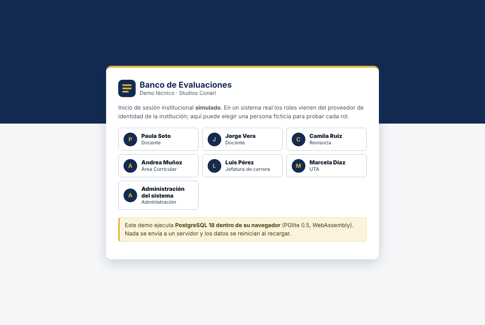 | 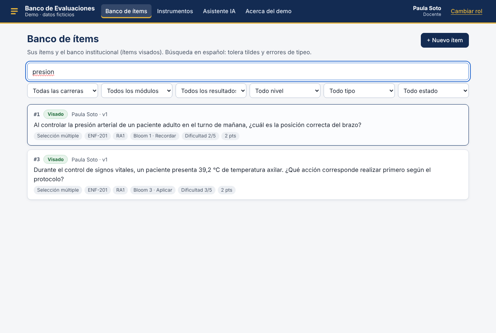 |
| Inicio de sesión simulado por rol | Búsqueda de «presion» sin tilde |
| 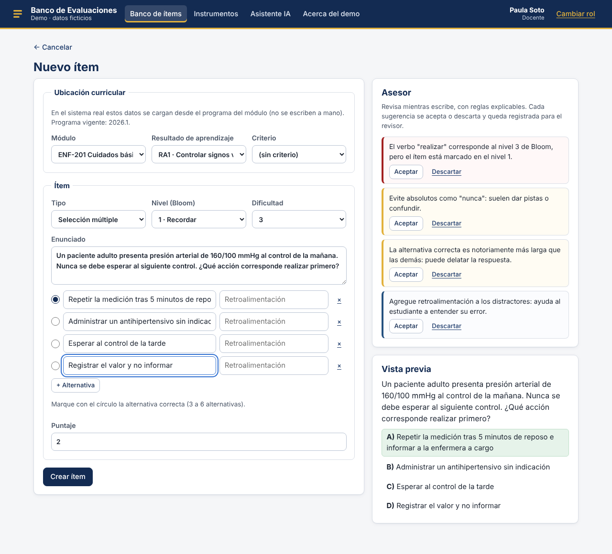 | 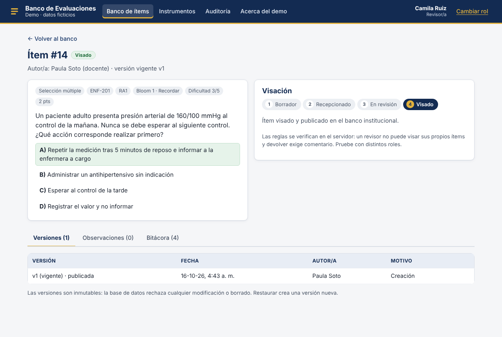 |
| Editor de ítems con asesor por reglas | Ítem visado por la revisora |
| 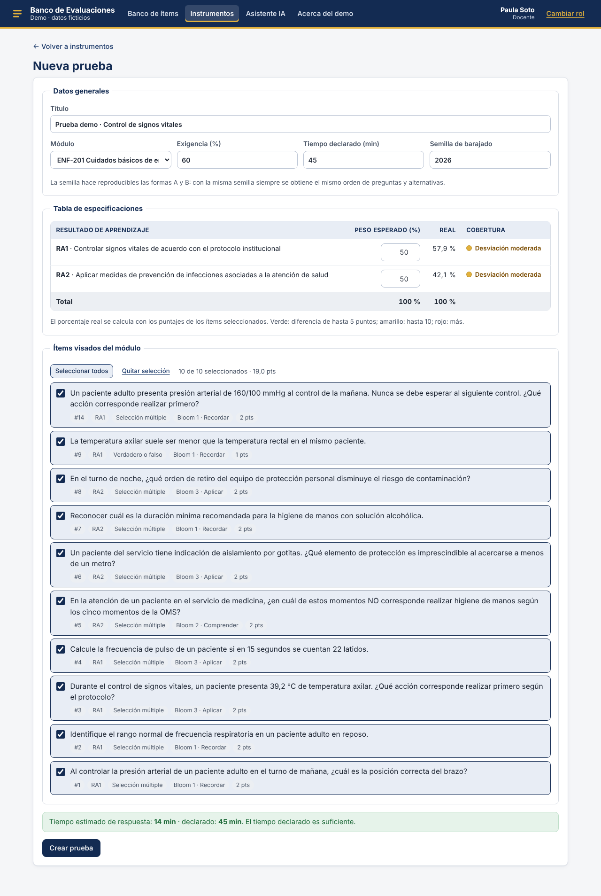 | 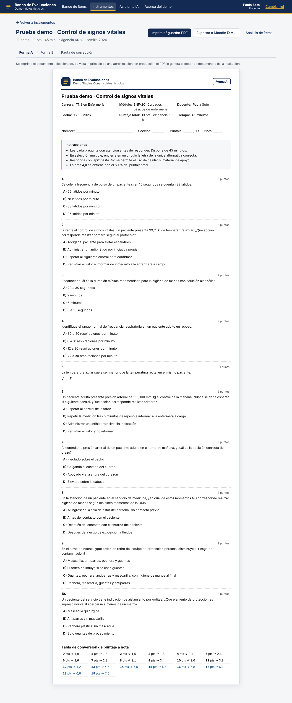 |
| Tabla de especificaciones con semáforo | Forma A imprimible con conversión a nota |
| 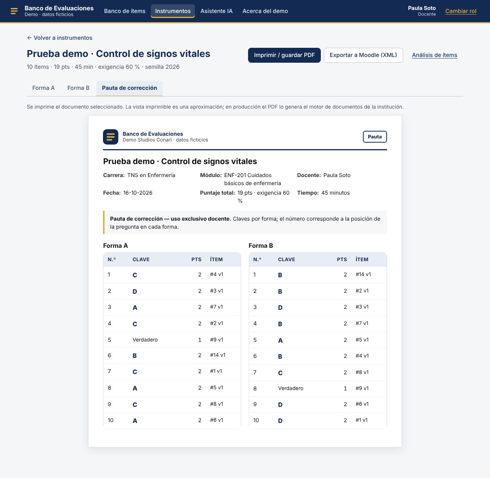 | 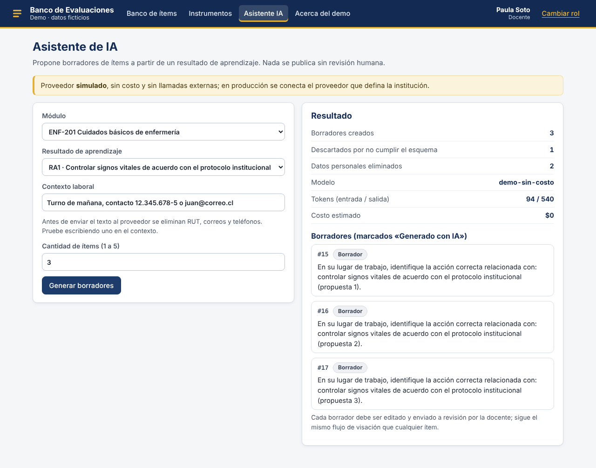 |
| Pauta de corrección por forma | Asistente de IA (proveedor simulado) |
| 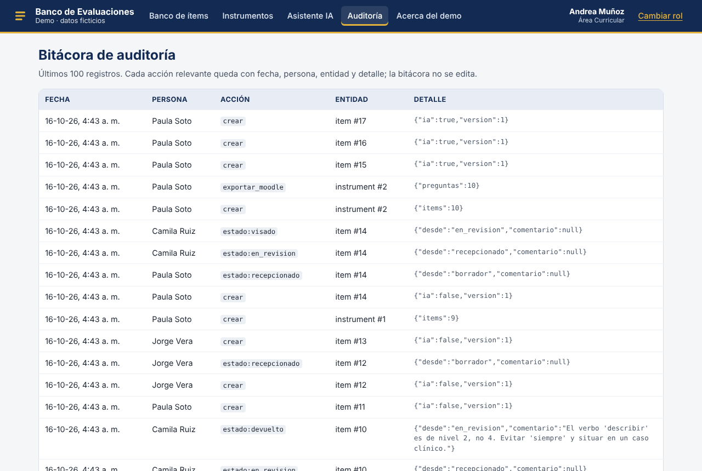 | 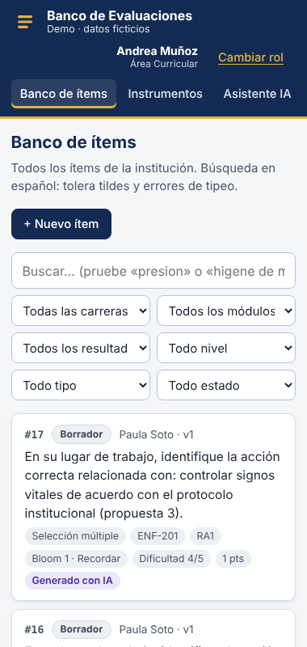 |
| Bitácora de auditoría | Vista en pantalla de 380 px |

## Licencia

© 2026 Studios Conari SpA. Todos los derechos reservados. Ver [`LICENSE`](LICENSE).
Los componentes de terceros (React, Node.js, Express, PostgreSQL, PGlite, Zod, Vite y otros) se rigen por sus propias licencias.
