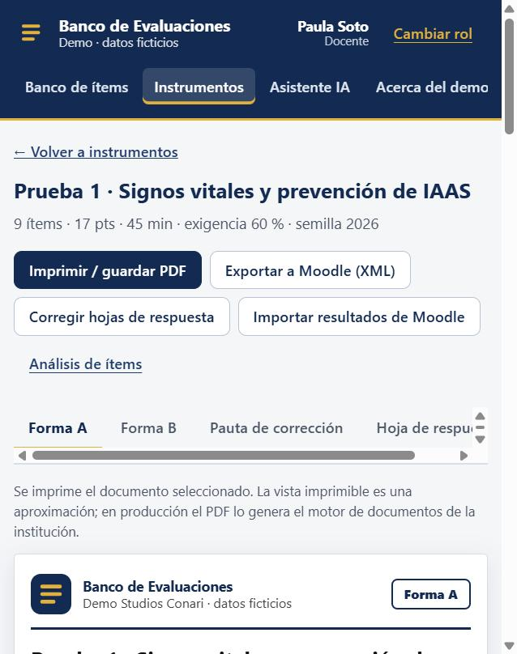
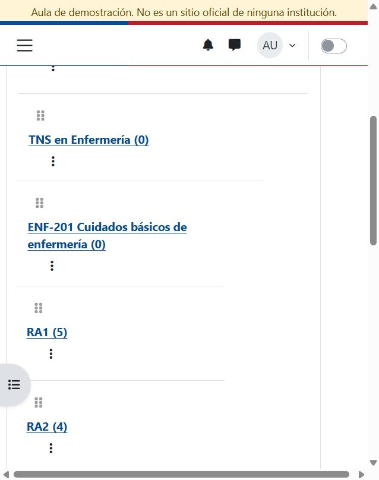
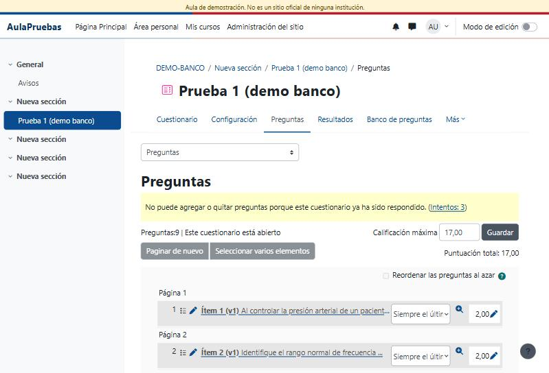
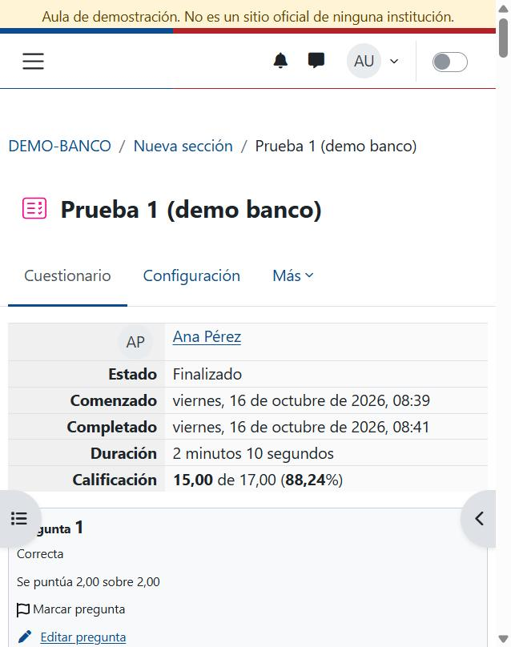
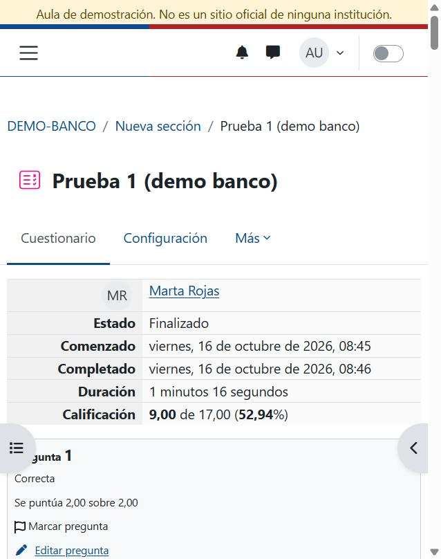
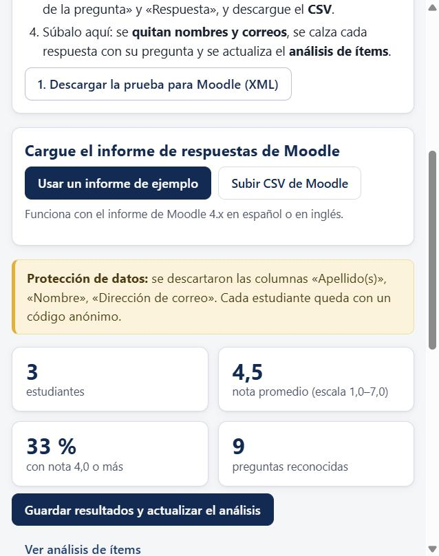
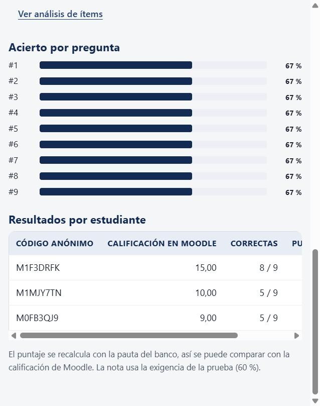
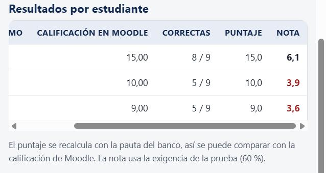
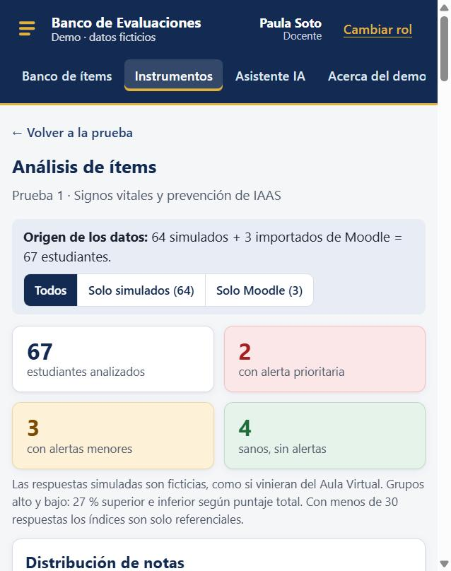
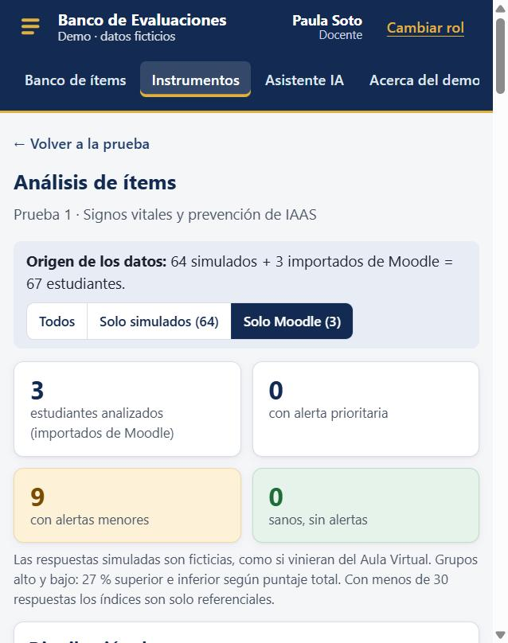

# Prueba de integración: Banco de Evaluaciones ↔ Moodle 4.5

**Fecha:** 16 de octubre de 2026 · **Resultado:** ✅ aprobada, de punta a punta

Este informe documenta una prueba real del ciclo completo:

1. La prueba sale del Banco de Evaluaciones.
2. Se rinde en un Moodle 4.5 en la nube.
3. Los resultados vuelven al banco para el análisis de ítems.

No es una simulación: se usó un aula Moodle 4.5 LTS desplegada en Google Cloud Run (ambiente **QA**) con tres estudiantes ficticios que respondieron el cuestionario.

> Todos los datos son de prueba. Los estudiantes (Ana Pérez, Luis Soto y Marta Rojas) son ficticios y sus correos usan el dominio reservado `localhost.test`. No se usaron datos personales reales ni el ambiente de Producción.

---

## Resumen de resultados

| Verificación | Esperado | Obtenido |
|---|---|---|
| Preguntas importadas en Moodle desde el XML del banco | 9 | ✅ 9, con sus categorías carrera → módulo → resultado de aprendizaje |
| Puntaje total del cuestionario | 17 puntos | ✅ 17,00 |
| Estudiantes que rindieron en Moodle | 3 | ✅ 3 intentos finalizados |
| Nota entregada por Moodle al instante | Sí | ✅ 15 · 10 · 9 de 17 |
| Preguntas reconocidas por el banco al importar el CSV | 9 de 9 | ✅ 9 (8 de selección múltiple + 1 de verdadero o falso) |
| «Calificación en Moodle» = «Puntaje» recalculado por el banco | Iguales | ✅ 15,0 = 15,0 · 10,0 = 10,0 · 9,0 = 9,0 |
| Datos personales en el banco | Ninguno | ✅ Se descartaron nombre, apellido y correo; solo quedan códigos anónimos |
| Origen de los datos en el análisis | Distinguible | ✅ «64 simulados + 3 importados de Moodle», con filtro por origen |

---

## Ambiente usado

| Componente | Detalle |
|---|---|
| Banco de Evaluaciones | Demo publicado: https://manecist.github.io/banco-evaluaciones-demo/ (perfil docente «Paula Soto») |
| Moodle | **4.5 LTS**, aula de demostración de Studios Conari en **Google Cloud Run, ambiente QA**: https://aula-qa-289115590175.us-central1.run.app |
| Curso de prueba | «Demo Banco de Evaluaciones (prueba)» (DEMO-BANCO) |
| Cuestionario | «Prueba 1 (demo banco)»: 9 preguntas, calificación máxima 17 |
| Estudiantes | 3 cuentas ficticias con rol Estudiante |

---

## Paso a paso

### 1. La prueba sale del banco

Como docente, en **Instrumentos → Prueba 1 → Exportar a Moodle (XML)** se descargó [`banco-moodle-prueba1.xml`](banco-moodle-prueba1.xml). El archivo contiene 9 preguntas con sus puntajes, claves y retroalimentación.

### 2. Moodle importa las preguntas

En el curso: **Banco de preguntas → Importar → formato Moodle XML**. Moodle informó «Importando 9 preguntas desde archivo». Las preguntas quedaron en las categorías del banco: **TNS en Enfermería → ENF-201 → RA1 (5) y RA2 (4)**.

### 3. Se arma el cuestionario

Se creó el cuestionario «Prueba 1 (demo banco)» con las 9 preguntas importadas. La puntuación total es **17,00**, igual que en el banco.

### 4. Los estudiantes rinden y Moodle califica al instante

Se matricularon 3 estudiantes ficticios. Cada uno rindió el cuestionario con errores a propósito, para que el análisis tuviera variación:

| Estudiante ficticio | Errores planificados | Nota de Moodle |
|---|---|---|
| Ana Pérez | pregunta 7 | **15,00 / 17** (88 %) |
| Luis Soto | preguntas 1, 4, 8 y 9 | **10,00 / 17** (59 %) |
| Marta Rojas | preguntas 2, 3, 5 y 6 | **9,00 / 17** (53 %) |

  

### 5. Se descarga el informe de respuestas

En el cuestionario: **Resultados → Respuestas**, con «Texto de la pregunta» y «Respuesta» marcados → **Descargar como CSV**. Archivo: [`moodle-respuestas-prueba1.csv`](moodle-respuestas-prueba1.csv). Contiene los datos ficticios tal como los entrega Moodle; los nombres y correos se quitan en el paso siguiente.

### 6. Los resultados vuelven al banco, sin datos personales

En el banco: **Prueba 1 → Importar resultados de Moodle → Subir CSV de Moodle**. El banco:

- reconoció las **9 preguntas**;
- descartó las columnas «Apellido(s)», «Nombre» y «Dirección de correo» y asignó un **código anónimo** a cada estudiante;
- recalculó el puntaje con su propia pauta, y coincidió con la calificación de Moodle en los 3 casos.

 

### 7. Se actualiza el análisis de ítems

Al guardar, el análisis muestra el origen de los datos: **64 simulados + 3 importados de Moodle = 67 estudiantes**. Los botones permiten ver solo una de las fuentes. Con el filtro **«Solo Moodle (3)»**, el banco advierte correctamente que con menos de 30 respuestas los índices son solo referenciales.

 

---

## Qué demuestra esta prueba

| Paso | Dónde | Qué pasa |
|---|---|---|
| ✍️ Preparar | Banco | La prueba se arma con preguntas revisadas y aprobadas |
| 📤 Enviar | Banco → Moodle | Moodle importa el XML: preguntas, puntajes, claves, retroalimentación y categorías |
| 💻 Rendir | Moodle | Los estudiantes responden en el Aula Virtual y reciben su nota al instante |
| 📥 Volver | Moodle → Banco | El informe de respuestas vuelve **sin datos personales** |
| 📊 Mejorar | Banco | El análisis detecta preguntas difíciles, confusas o con la clave dudosa, y distingue el origen de los datos |

**El banco no necesita acceso a Moodle ni claves:** la integración se hace solo con los dos archivos estándar de Moodle (XML de preguntas y CSV del informe de respuestas). Por eso funciona con cualquier Moodle 4.x de la institución.

## Archivos de evidencia

| Archivo | Contenido |
|---|---|
| [`banco-moodle-prueba1.xml`](banco-moodle-prueba1.xml) | Prueba exportada desde el banco (formato Moodle XML) |
| [`moodle-respuestas-prueba1.csv`](moodle-respuestas-prueba1.csv) | Informe de respuestas descargado de Moodle 4.5 (estudiantes ficticios) |
| [`capturas/`](capturas/) | Capturas de cada paso |
